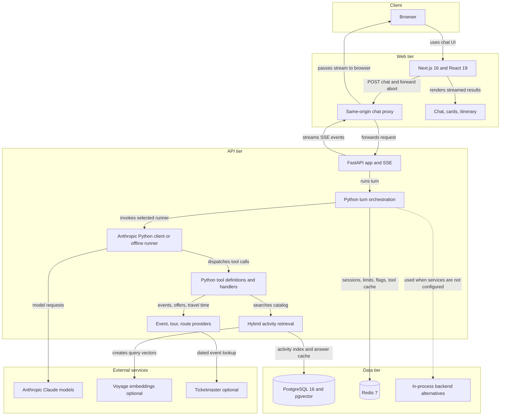
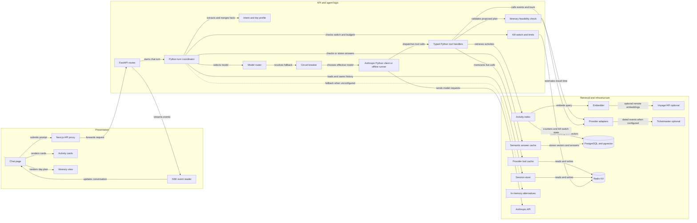

# Architecture Diagram

Trip Genie uses a Next.js/React frontend and a Python/FastAPI API. The API coordinates streamed AI responses, activity retrieval, optional live event data, session state, and safety controls; PostgreSQL/Redis can be replaced by in-process backends for local or offline use.

## Application Architecture

<!-- mermaid-checked: no \n, no em-dash/en-dash, no {} in labels, subgraphs are id["label"], arrows are -->|"label"|, all subgraphs closed by end, ids unique -->


### Technology Stack Summary

| Layer | Technology | Version | Purpose |
| --- | --- | --- | --- |
| Workspace | pnpm | 10.28.0 | Monorepo package management and scripts |
| Web | Next.js, React, TypeScript | ^16.4.3, ^19.3.1, ^7.0.2 | Chat UI, same-origin API proxy, streamed event rendering |
| API | Python, FastAPI, Uvicorn | Python 3.12 container; package ranges in requirements.txt | HTTP endpoints, async SSE streaming, application orchestration |
| Agent | Anthropic Python SDK and Python tool loop | anthropic package range in requirements.txt | Model calls, typed tool dispatch, fallback and offline runner |
| Validation | Pydantic | package range in requirements.txt | Request and tool argument validation |
| Persistence | PostgreSQL, pgvector, asyncpg | PostgreSQL 16 image; asyncpg and pgvector package ranges | Activity catalog, vector/full-text retrieval, answer cache |
| Key-value | Redis, Python Redis client | Redis 7 image; redis package range | Sessions, rate/spend counters, kill switch, tool cache |
| Embeddings | Hashed embedder or Voyage AI | 256 dimensions; Voyage model `voyage-3.5-lite` | Semantic retrieval and answer-cache similarity |

Frontend versions are the declared npm package ranges. Database and Redis versions are the Docker Compose image tags. Python dependency ranges are declared in the API requirements manifest.

### Data Storage & External Services

In the Compose setup, PostgreSQL 16 with pgvector stores activities, generated embeddings, full-text search data, catalog version, and answer-cache entries. Redis 7 holds session profiles/history, safety counters and flags, and cached provider results. In-memory implementations support local/offline use. Activity search applies city/category/price hard filters and combines vector and keyword rankings with reciprocal-rank fusion. The seed catalog is illustrative. Ticketmaster is used when configured; tour offers and route-time estimates currently use mock/Haversine providers. Voyage embeddings are optional; otherwise a local hashed embedder is used. Model-backed turns require the Anthropic key; otherwise the offline runner invokes the same tool handlers.

### Key Architectural Decisions

- A same-origin Next.js route proxies the API's Server-Sent Events stream and forwards browser cancellation so the agent run can be aborted.
- The Python API isolates model access behind a runner interface, supports deterministic model routing and fallback/circuit breaking, and provides an offline implementation for demos and tests.
- Activity cards and itinerary stops are restricted to IDs returned by tools during that turn; itineraries are checked for valid activities, operating-day time bounds, and travel-time feasibility.
- Kill switch, rate limits, estimated session-spend tracking, per-turn limits, tool caching, and semantic answer caching surround the agent workflow. Token rates are configurable estimates and should be checked against current provider pricing.

## Component Relationships

<!-- mermaid-checked: no \n, no em-dash/en-dash, no {} in labels, subgraphs are id["label"], arrows are -->|"label"|, all subgraphs closed by end, ids unique -->


The FastAPI chat route creates or reuses a session ID and streams typed events for status, text, cards, itinerary, completion metadata, and errors. The Python coordinator checks the kill switch and budgets, updates intent/profile state, checks the semantic cache, chooses a model, runs the agent loop, and records history/spend. Typed Python tools perform retrieval/provider calls and emit UI events; model output does not directly create arbitrary booking links.

### Component Inventory

| Component | Layer | Type | Responsibility |
| --- | --- | --- | --- |
| Chat page | Presentation | Next.js client page | Collects prompts, stores session ID in local storage, streams and displays turn state |
| SSE event reader | Presentation | Async stream parser | Parses event frames from the response body |
| Next.js API proxy | Presentation | Route handler | Forwards chat requests and cancellation to the API |
| Activity cards | Presentation | React component | Displays ranked activity details and booking links |
| Itinerary view | Presentation | React component | Displays day-by-day stops and their associated activities |
| FastAPI routes | API | Python HTTP/SSE server | Exposes health, chat, and authenticated kill-switch endpoints |
| Python turn coordinator | Business logic | Async agent workflow service | Applies gates, intent, cache, model execution, and bookkeeping |
| Intent and trip profile | Business logic | Rule-based extractor and session profile | Extracts destination, interests, budget, party, dates, and constraints |
| Model router | Business logic | Deterministic routing policy | Selects standard or planner model based on request complexity |
| Circuit breaker | Business logic | Resilience component | Routes around transient model failures using fallbacks |
| Anthropic Python client or offline runner | Business logic | Runner abstraction | Streams the model response or deterministically exercises the same tools |
| Typed Python tool handlers | Business logic | Tool dispatch layer | Search activities, find events/offers, estimate travel, and emit cards/plans |
| Itinerary feasibility check | Business logic | Validator | Checks IDs, times, day bounds, and travel gaps |
| Kill switch and limits | Cross-cutting | Safety controls | Enforces operating mode, request limits, session budgets, and abort behavior |
| Activity index | Data access | Memory/PostgreSQL implementations | Filters and ranks the activity catalog with hybrid retrieval |
| Semantic answer cache | Data access | Memory/PostgreSQL implementations | Reuses eligible answers by intent, embedding similarity, and catalog version |
| Session store | Data access | KV-backed store | Persists trip profile and bounded conversation history with a TTL |
| Provider tool cache | Data access | KV-backed cache | Caches event and tour provider responses |
| Provider adapters | Integration | Events, tours, routes | Supplies Ticketmaster or mock events, mock tours, and estimated route times |
| PostgreSQL and pgvector | Infrastructure | Relational/vector database | Stores catalog, indexes, catalog version, and cached answers |
| Redis KV | Infrastructure | Key-value store | Stores sessions, flags, counters, and tool-cache values |
| In-memory alternatives | Infrastructure | Local adapters | Supports offline development and tests when external stores are absent |
| Anthropic API | External integration | Model service | Provides Claude models for live agent runs |
| Voyage API | External integration | Embedding service | Optional remote text embeddings |
| Ticketmaster | External integration | Event API | Optional dated event search |
```